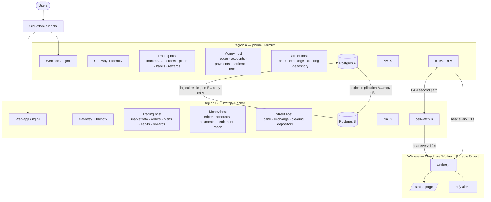

# sprout-platform

How [Sprout](https://sainayakk.github.io/sprout-platform/)'s services are put together, released and proven.

Read the [Sprout in ten minutes walkthrough](https://sainayakk.github.io/sprout-platform/walkthrough/) for a step-by-step tour of the system.

## What Sprout is

Sprout is a simulated brokerage: accounts, deposits, orders, an exchange, clearing, settlement, a
depository, statements and reconciliation, split into 19 services in Java 21 / Spring Boot, an Angular
web app, Postgres and NATS. It runs live as two cells: Region A on an Android phone (Termux) and Region
B on a laptop (Docker). Each cell serves its own customers and holds a replicated copy of the other
cell's database, so it can serve both when the other is lost.

**Site:** https://sprout-saiworks.nncs.in  
**Status page:** https://sprout-saiworks.nncs.in/status  
**Docs:** https://sainayakk.github.io/sprout-platform/

## Architecture



Region A and Region B each run the full stack, and each customer belongs to one of them.
cellwatch on each cell watches the other, takes over if the other is lost, and gives the customers back
automatically when the other returns. The witness (a Cloudflare Worker and Durable Object) is the third
party neither cell controls: it must grant a takeover before it can start, and it serves the public
status page and pushes alerts via ntfy.

## Resilience, measured

From the [resilience suite](docs/reliability/resilience.md) on 2026-10-28: all 10 scenarios pass, 7,000 orders placed
during failures, 0 lost, 0 applied twice. More in [chaos tests](docs/testing/chaos.md).

| Scenario | Result |
|---|---|
| Whole cell lost (phone) | Its customers served again in **176 s**; 0 orders lost, 0 doubled |
| Whole cell lost (laptop) | Its customers served again in **258 s**; 0 orders lost, 0 doubled |
| Failback cutover (writes refused) | **2–5 s** |
| Cell cut off from the other, but the witness sees it alive | No takeover (witness vetoes it) |
| Takeover threshold at the witness | **90 s** of silence (phone on mobile data drops for 30–60 s at times) |
| Witness unreachable | Cells fall back to their own rules (fail open); witness never required |
| Both cells silent for 3 minutes | Alert pushed to owner's phone |

## How it is proven

- **Pre-prod on every PR:** create environment, run the full end-to-end suite, performance tests,
  reconciliation, destroy, publish evidence.
- **Resilience suite** (`deploy/cells/resilience/`): each scenario breaks one thing, waits for the
  cells to repair themselves, and checks that every acknowledged order exists exactly once.
- **Witness unit tests:** Worker tests for the 89 s / 90 s grant boundary and state transitions.
- **cellwatch decision-logic unit tests:** `python -m unittest discover -s deploy/cells -p 'test_cw_*.py'`;
  several cases are incidents from the live cells, written down so they stay fixed.

## Repository layout

| Path | What |
|---|---|
| `hosts/` | Deployable hosts (`edge`: gateway + identity, and the sandbox where it runs; `trading`: market data, orders, plans, habits, rewards; `money`: ledger, accounts, payments, settlement, statements, recon, goals; `street`: Sprout Bank, the exchange, clearing, the depository). Each `pom.xml` is a **release manifest**: the exact service versions that host runs. `install-services.sh` builds each of those services from its release tag. |
| `preprod/` | The disposable pre-prod environment and `run.sh`, which creates it, tests it and destroys it. |
| `e2e/` | The end-to-end suite, run through the gateway like a real client, and the price fan-out load test. |
| `docs/` | The documentation site, including the evidence from every pre-prod run. |
| `deploy/cells/` | cellwatch: the program on each cell that watches the other, takes over and gives back; the resilience suite and chaos scripts. |
| `deploy/witness/` | The Cloudflare Worker witness: neither cell controls it; it grants or vetoes takeovers, serves the public status page, and pushes alerts. |
| `deploy/laptop/` | How the laptop cell is installed: Docker Compose rendered from pre-prod's compose file, with real secrets and persistent data. |
| `deploy/phone/` | How the phone cell is installed: `start.sh` runs under Backseat (Termux), starts one piece at a time, keeps them running, and manages `sprout start` / `sprout stop`. |

## Run pre-prod locally

Needs Docker, Java 21, Maven, git and Python 3.

```bash
preprod/run.sh                  # create, test, write evidence, destroy
preprod/run.sh --keep           # leave it running on http://localhost:8100
preprod/run.sh --observability  # also Grafana on http://localhost:3000
```

## Related repositories

- [sprout-contracts](https://github.com/SaiNayakk/sprout-contracts): every API and event, versioned
- [sprout-identity](https://github.com/SaiNayakk/sprout-identity): accounts, two-factor, sessions, tokens
- [sprout-gateway](https://github.com/SaiNayakk/sprout-gateway): the public edge
- [sprout-marketdata](https://github.com/SaiNayakk/sprout-marketdata): the simulated market and live prices

## Licence

MIT
