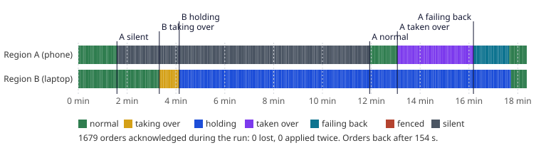
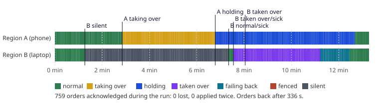

# Resilience

What the two cells do when something fails, how fast, and how that is checked. The design is
[ADR-027](../decisions.md#adr-027-cells); the audit that led to this version is [Resilience audit](audit.md).

## What happens, with no hands

| Something fails | What the cells do | Orders work again |
|---|---|---|
| A **host** of one cell stays down | It fences itself after a minute and says why; the other cell takes its customers over 30 s after that announcement; when the host is back and stable for 3 minutes the customers are **given back automatically** (3 s of refused writes) | **175 s** (was 813 s) |
| A host crashes and restarts itself | Nothing: a 30 s blip is not a failure, and nothing is fenced | 27 s |
| Every host of a cell restarts at once (Docker Desktop restarts, the laptop reboots) | Nothing is fenced: crash loops are counted per host, so hosts coming up together are not one host crashing again and again | about 1 minute |
| A cell's hosts all stop, but its watcher keeps running | It fences when its address goes silent, says it is out once its hosts have been down a minute, and the other cell takes over | |
| A **whole cell** is lost (the phone, or the laptop) | The other cell sees its address go silent and takes over; when the lost cell is back it is given its customers back | **176 s** (phone), **258 s** (laptop) |
| Cloudflare shows each cell silent to the other, but both are fine | The home network shows both up: **nobody takes anybody over** | no interruption |
| The cells cannot see each other at all (both paths), but both reach the witness | The [witness](#the-witness) sees both alive and **forbids any takeover**: nobody leaves NORMAL | no interruption (longest gap between orders 3 s) |
| The cells cannot see each other, and the witness cannot be reached either | Each may take the other over (the old behaviour: the witness is never required); when they can see each other again, **one gives way** and the customers are handed back | back to normal 164 s after healing |
| Both addresses go silent (the home internet drops) | Both fence, neither takes the other over, and both **unfence 45 s after the addresses are back** (was 211 s) | writes refused for the outage plus 45 s |
| A takeover cannot start its standby | It rolls back, puts the replication it paused back on, and tries again in 2 minutes | |
| The cell holding another's customers dies too | The cell it held resumes from its own database after 5 minutes, replays what the holder journalled with it, takes the dead holder over, and gives way when the holder returns | see `holder_dies` in the [suite](../testing/chaos.md#resilience-suite) |
| Replication stops silently | The watcher turns it back on within 30 s and alerts | |
| A slow other cell | The journal's circuit opens after a few failures: the healthy cell keeps its speed (**22.7 orders/s against 23.8**; it was 5.8 against 40) | |

A cell that is being taken over takes no writes: when it sees the other cell start taking it over it fences, and it does not
unfence until the takeover has finished or been abandoned (on 2026-10-28 a cell unfenced in the middle of one, and both served
its customers for 100 s).

After a handback the holder **resumes its copy** of the cell it gave back instead of copying it all again (which took about 20
minutes, during which that cell could not be taken over). At the cutover the returning cell's new database is the holder's copy;
the returning cell makes a replication slot at its swap, before it takes any write, and the holder subscribes from it. The holder
first checks, with a slot it made at the cutover point, that nothing reached its copy after that point; if something did, it
rebuilds as before.

Every one of these ends, by itself, with both cells NORMAL and replicating, and with every order a customer was told
succeeded present exactly once.

## The witness

A small Cloudflare Worker (`deploy/witness`, free plan) that neither cell controls. Each cell tells it every 10 s that it is alive and in
what state; that is its **lease**. The status page shows a region as not responding after 30 s of silence, but another cell may take it
over only after **90 s** (2026-10-20: the phone, on mobile data, went quiet for about 40 s, the laptop took it over, and getting its customers back
took 12 minutes; see [Incidents](../incidents.md)).

- A cell may take the other over only if the witness says the other's lease has lapsed, or that the other declared itself out. A cell
  that both paths show nothing of, but that the witness hears, is alive: that ends the double takeover.
- The witness's word also shortens detection of a dead cell a little (90 s instead of 120 s). End to end the gain is small (177 s and 276 s to
  orders back, against 151 s and 221 s before: the standby's start and the journal's replay take most of the time, and the laptop's figure
  includes Docker). It was 30 s until the phone moved to mobile data, whose short dropouts looked like deaths.
- **It is never required.** If a cell cannot reach it, the cell decides as it did before there was one. So the witness can only add a
  veto or a faster verdict; it cannot stop a failover by being down. The cost is that two failures at once (a blind pair and a dead
  witness) still give the old double takeover, which still heals itself.
- It serves the public status that the website's status pill and `/status` page read, and, once a minute, checks whether both cells are
  silent: if both have been for 3 minutes it pushes an alert to the owner's phone (the dead-man's switch).

## Alerts

Each cell pushes to the owner's phone ([ntfy](https://ntfy.sh), a private topic) for: a fence and why, a takeover and
how long it took, a failure, a failback and its cutover time, a double takeover, replication off or behind, a lost
replication slot, writes that have no copy in the other cell, a nearly full disk, clocks that disagree, and (on the phone)
the battery. Alerts are logged whether or not a topic is set.

## The resilience suite

```
python deploy/cells/resilience/run.py [scenario ...]
```

Needs both cells up. Each scenario creates customers who keep ordering through the public address, breaks something,
waits for the system to repair itself, and checks the time to recover, that **every order acknowledged exists exactly
once**, and that both cells are NORMAL and replicating again. Scenarios: `dead_host`, `kill_cell_a`, `kill_cell_b`,
`cf_blind`, `mutual_blind`, `blind_no_witness`, `both_offline`, `failed_takeover`, `holder_dies`, `laptop_restart`. Results are kept in
[`deploy/cells/results/`](https://github.com/SaiNayakk/sprout-platform/tree/main/deploy/cells/results) (a JSON per run and the
states every few seconds). The rules themselves are tested with `python -m unittest discover -s deploy/cells -p 'test_cw_*.py'`,
which runs in CI: each test is an incident (a returning cell that unfenced too soon, a cell fenced again by a stale status,
two cells holding each other) written down.

### Every scenario's latest run

Written by `python docs/figures/build.py` from the run files in
[`deploy/cells/results/`](https://github.com/SaiNayakk/sprout-platform/tree/main/deploy/cells/results); nothing in it is typed by hand.

<!-- figures:begin (written by docs/figures/build.py) -->
| Scenario | Latest run | Result | Orders back after | Orders acknowledged | Lost | Applied twice |
|---|---|---|---|---|---|---|
| `kill_cell_a`: the phone's cell stopped | 29/10 21:44 | pass | 154 s | 1679 | 0 | 0 |
| `kill_cell_b`: the laptop's cell stopped | 29/10 21:58 | pass | 336 s | 759 | 0 | 0 |
| `dead_host_trading`: one JVM host killed | 28/10 11:48 | pass | 308 s | 754 | 0 | 0 |
| `holder_dies`: the cell serving both dies | 28/10 09:52 | pass | - | 938 | 0 | 0 |
| `cf_blind`: the cells can't see each other | 28/10 11:35 | pass | - | 580 | 0 | 0 |
| `mutual_blind`: the cells can't see each other at all | 28/10 12:01 | pass | - | 741 | 0 | 0 |
| `blind_no_witness`: blind to each other and to the witness | 28/10 12:12 | pass | - | 998 | 0 | 0 |
| `both_offline`: both public addresses down | 28/10 11:53 | pass | - | 180 | 0 | 0 |
| `failed_takeover`: a takeover that can't finish | 28/10 13:08 | pass | - | 272 | 0 | 0 |
| `replication_off`: replication silently switched off | 28/10 09:36 | pass | - | - | - | - |
| `laptop_restart`: the laptop's containers all restarted | 29/10 02:58 | pass | 45 s | 158 | 0 | 0 |
<!-- figures:end -->

**The phone's cell stopped** (latest `kill_cell_a`): both cells' states through the run, as the suite saw them.



**The laptop's cell stopped** (latest `kill_cell_b`):



### Copy resume check: 2026-10-29, v0.18.1 code

`kill_cell_a` and `kill_cell_b` run again to check that the cell that held the other's customers resumes its copy after the
handback instead of copying the whole database again. Both pass, and in both the holder's log says it resumed the copy and the
copy was whole at once.

| Scenario | Result | |
|---|---|---|
| `kill_cell_a` | pass | orders back after 154 s; both NORMAL 794 s after the phone's cell started again; copy resumed |
| `kill_cell_b` | pass | orders back after 336 s; both NORMAL 322 s after the laptop's cell started again; copy resumed |

### Latest full run: 2026-10-28, v0.18.0 code

Both cells on the home network, the phone on charge. 7,000 orders acknowledged during the failures; **0 lost, 0 applied twice**.

| Scenario | Result | |
|---|---|---|
| `kill_cell_a`: the phone's cell stopped | pass | the laptop served its customers again after **176 s** |
| `kill_cell_b`: the laptop's cell stopped | pass | the phone served its customers again after **258 s** |
| `dead_host`: one JVM host killed | pass | fenced after 91 s, orders back after 308 s |
| `holder_dies`: the cell serving both dies | pass | |
| `cf_blind`, `mutual_blind`: the cells cannot see each other | pass | no takeover; longest pause between orders 2.7 s |
| `blind_no_witness`: blind to each other and to the witness | pass | the cells fall back to their own rules |
| `both_offline`: both public addresses down | pass | |
| `failed_takeover`: a takeover that cannot finish | pass | |
| `replication_off`: replication silently switched off | pass | switched back on, the copy has every order |

The first attempt that day failed 7 of 10, all on the test side: the suite reached the phone by an address it no longer had,
so nothing it asked of the phone happened and every order looked missing. The scripts now use the ssh alias and stop when the
phone cannot be reached. A second attempt showed `kill_cell_a` waiting 17 minutes to take over: it began while the laptop was
still rebuilding its copy of the phone after the previous scenario, and a cell never takes over from a partial copy. Scenarios
now start only when both copies are whole.

## Not done yet

- **Boot.** The laptop starts Docker only after someone signs in to Windows (two unclean reboots in October left it waiting at
  the sign-in screen); the phone restarts Sprout after a reboot by itself (Termux:Boot).
- **A warm standby** (taking over in seconds instead of about 90 s): the standby's start is now most of the time to recover.
- **The phone's cellwatch was killed once without a trace** on 2026-10-11 (the log is silent; the starter had just started it) and
  nothing restarted it until it was started by hand. The witness noticed within 30 s and the laptop began a takeover that its own
  checks aborted, but a watcher of the watcher is needed.
