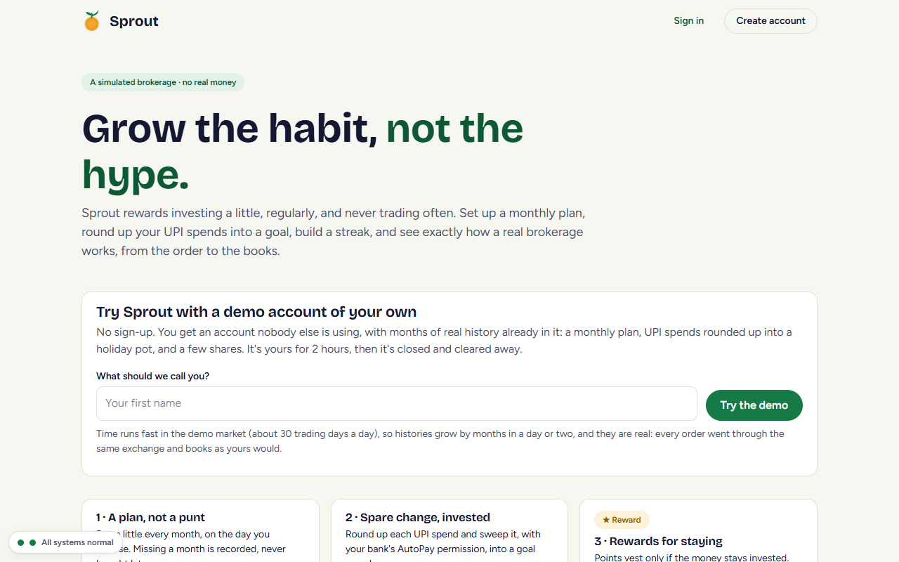
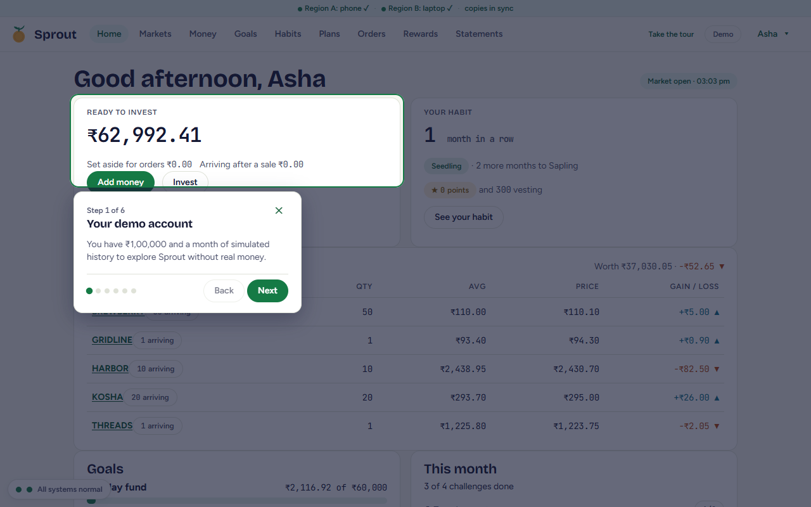
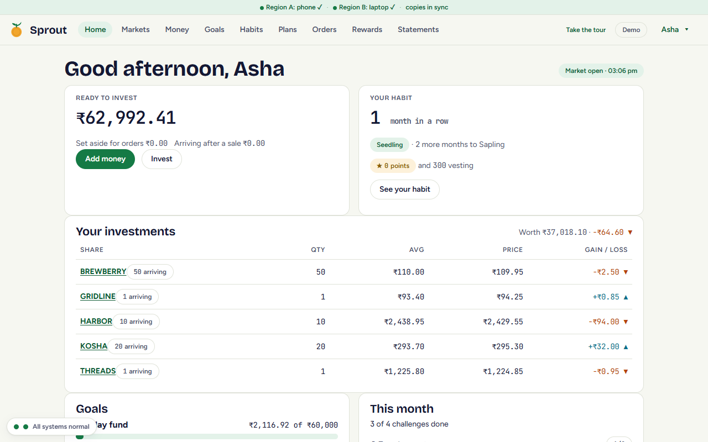
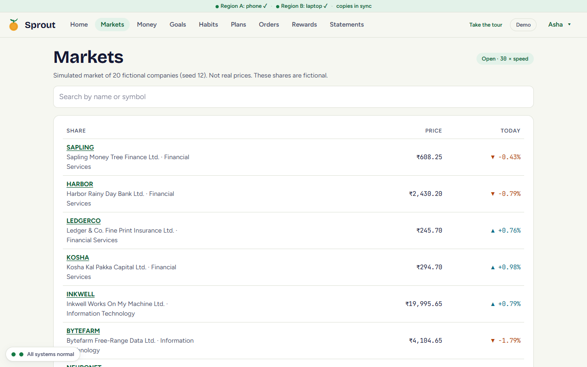
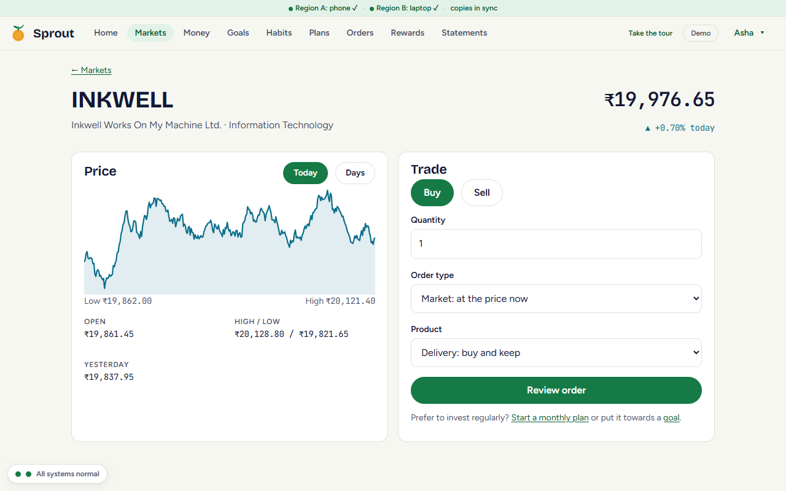
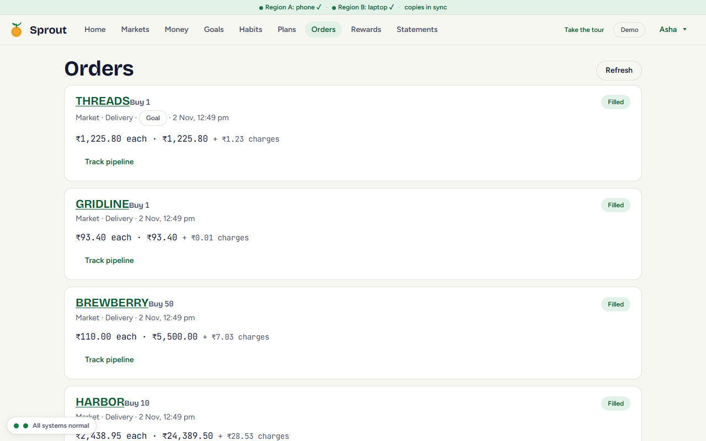
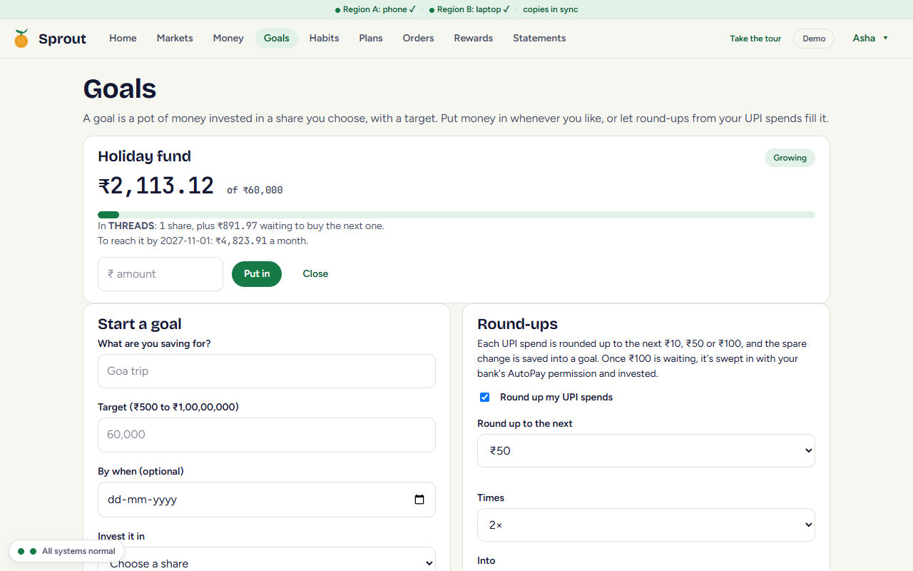
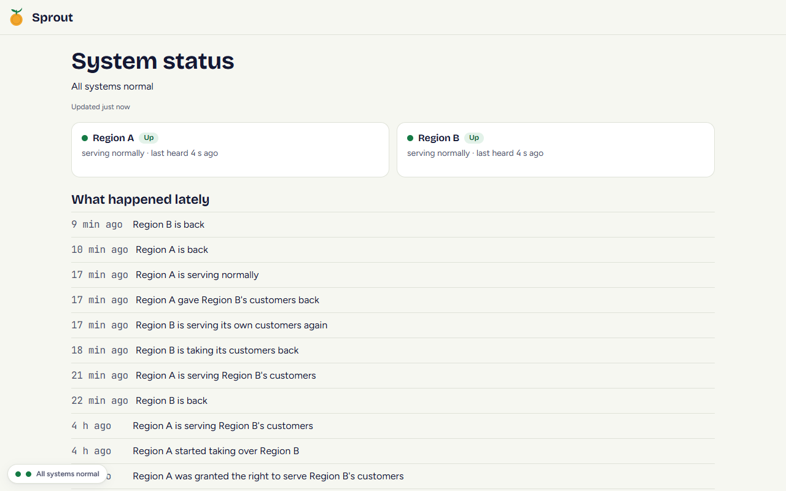
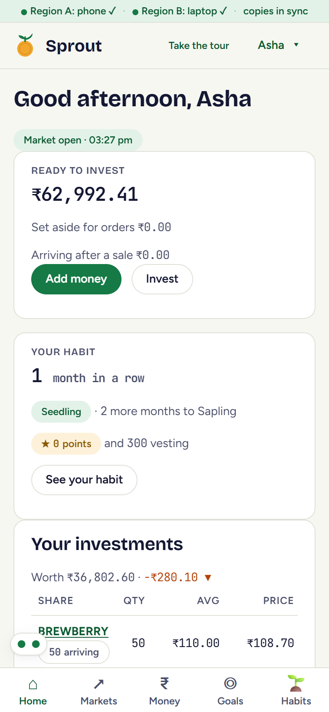
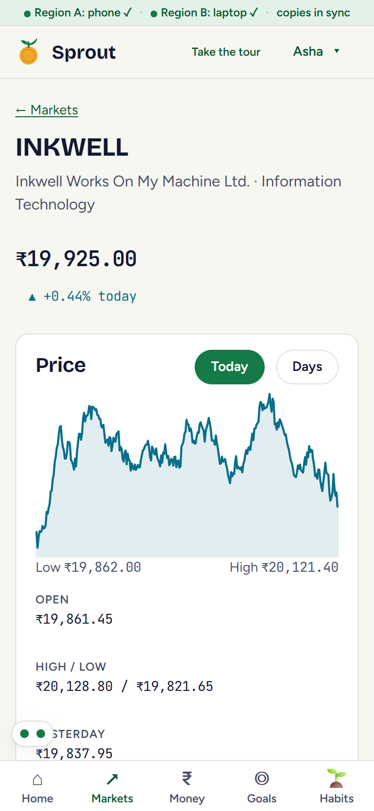

# What it looks like

Screens from the live site, https://sprout-saiworks.nncs.in, taken on 2026-11-02 with a fresh demo account. Each
demo account starts with Rs 1,00,000 and two holdings, and lives a month of the fast market before a visitor gets
it. The stock names are jokes; the prices, orders and books behind them are real.

## Landing page

Anyone can try Sprout without signing up: type a name and get a demo account nobody else is using.

## The walkthrough

A demo starts with a six-step tour of the main screens. It can be skipped, and started again from the header.

## Home

Money ready to invest, the investing habit, holdings with live prices, goals and this month's challenges. The bar
at the top shows both regions and whether their copies of each other are in sync.

## Markets and a stock

Twenty fictional companies in a simulated market running at 30 times real speed. Prices stream live.

## Orders

Every order, filled or refused, with its charges. **Track pipeline** shows the order's path through the order
system, the exchange, clearing, settlement and the depository.

## Goals and round-ups

A goal is a pot invested in one share. Round-ups sweep spare change from UPI spends into it.

## Status

The public status page reads the witness: which region is up, who serves whose customers, and what happened lately.

## On a phone

| | |
|---|---|
|  |  |
