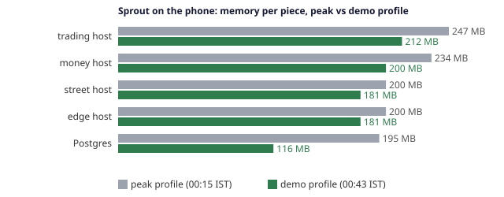

<div class="walkthrough-page"></div>

# Sprout in ten minutes

Sprout is a simulated Indian brokerage built from scratch to learn how real brokerages work at scale:
sign-in and two-factor authentication, live market data, orders, money movement, double-entry ledgers,
T+1 settlement, demat holdings and reconciliation.

It runs live as two cells: Region A on an Android phone (Termux) and Region B on a laptop (Docker).
Each cell serves its own customers and holds a replicated copy of the other cell's database.

## 1. What Sprout is

Sprout is split into 19 independent services in Java 21 and Spring Boot 3, an Angular web app,
Postgres and NATS. Each service owns one responsibility and its own database schema. No service reads
another's tables; all communication goes through published [contracts](contracts.md).

```
                                    +--------------------+
                                    |      Gateway       |
                                    +---------+----------+
                                              |
                   +--------------------------+--------------------------+
                   |                          |                          |
        +----------v---------+     +----------v---------+     +----------v---------+
        |   Trading Host     |     |     Money Host     |     |    Street Host     |
        | marketdata, orders |     | accounts, payments |     | bank, exchange     |
        | plans, habits      |     | ledger, settlement |     | clearing, demat    |
        +--------------------+     +--------------------+     +--------------------+
```

The market simulates twenty fictional companies whose prices behave like a real market ([ADR-008](decisions.md#adr-008-simulated-market)).
No real money moves, no real orders reach an exchange, and all company details are fictional.

The product rewards steady habits (SIP plans, streaks, badges, round-ups into pots) rather than frequent trading.
Delivery brokerage is free (`CNC`), while intraday positions (`MIS`) incur standard discount charges and are squared off before market close.

Visitors can explore without signing up: the public sandbox maintains demo accounts that live through the same APIs as real customers ([ADR-023](decisions.md#adr-023-sandbox), [ADR-026](decisions.md#adr-026-demo-accounts)).

## 2. Two regions, a phone and a laptop

Sprout runs across two physical machines that form two active cells ([ADR-027](decisions.md#adr-027-cells)):

- **Region A**: an Android phone running supervised native processes in Termux.
- **Region B**: a laptop running Docker Compose.

Both cells are reached through Cloudflare tunnels behind the public address (`sprout-saiworks.nncs.in`).
Each cell runs the full stack and serves its own partition of customers, split **35 : 65** between the phone and the laptop based on measured peak capacity.

```
Users ---> Cloudflare tunnels ---> Region A (phone, Termux)   <--- logical replication ---> Region B (laptop, Docker)
                                         |                                                        |
                                         +----------------> Witness (Worker) <--------------------+
```

Each cell maintains a logical replication copy of the other cell's Postgres database, plus a local journal of recent writes.

A third party neither cell controls—a Cloudflare Worker and Durable Object called the **witness**—receives a heartbeat lease every 10 s from each cell.
`cellwatch` on each cell monitors the other. If one cell goes silent for 90 s, the witness grants a takeover lease so the surviving cell can serve both sets of customers.

## 3. An order's way through the services

When a customer places an order, the request travels through four stages: **orders -> ledger -> exchange -> portfolio**.

```
Customer ---> Gateway ---> Orders (OMS) ---> Ledger (hold funds) ---> Exchange (fill) ---> Portfolio (holdings/charges)
```

1. **Orders (OMS)**: The customer submits an order with an `Idempotency-Key`. The gateway verifies the RS256 JWT access token, checks per-client rate limits, and forwards the request. The order service checks trading hours and instrument rules with market data, and acquires a per-customer lock.
2. **Ledger**: The order service blocks money in the ledger (`debit cash, credit order-hold`). The double-entry ledger is the only source of truth for funds. If the account balance is insufficient, the order fails immediately.
3. **Exchange**: The order service submits the order to the Sprout Stock Exchange (`clientOrderId = order id`). The simulated exchange executes the trade at the current market price or rests it in the order book.
4. **Portfolio & Settlement**: In a single database transaction, the order service records the fill, updates customer holdings or intraday margin positions, and posts the execution to the ledger. The hold is released, share value is transferred to clearing, and charges (STT, exchange fees, SEBI fees, stamp duty, GST) are credited to respective tax and income accounts. At T+1 settlement, the clearing corporation and depository deliver the shares into the customer's demat account.

Unknown outcomes are retried and reconciled, never guessed.

## 4. How much it handles

A capacity test passes when **p95 latency is under 1 s and under 1% of requests fail**.
One simulated user acts as a whole customer who pauses 2–6 s between actions, generating about 0.42 requests a second.

Headline numbers copied directly from [Capacity](reliability/capacity.md):

| Configuration | Users within the target | Requests a second | Most it ever served |
|---|---|---|---|
| Phone (cell A), alone | **300** | 124 | 143 req/s |
| Laptop (cell B), alone | **300** | 125 | 259 req/s |
| **Both at once** | **400** (200 + 200) | 167 | 267 req/s |
| Promised with one cell lost | ~200 (estimate, not yet measured) | | |

**400 people using Sprout at the same time, with p95 under a second**, on a phone and a laptop that cost nothing to run.

Other measured limits from the test suite:

- **Sign-ins**: **10 a second** within target (p95 0.37 s); at 12 req/s, p95 exceeds 5 s.
- **Live price streams**: **400 at once** held open simultaneously.
- **Screen views**: **20 a second** within target (p95 0.2 s).
- Customers are assigned between cells in a **35 : 65** ratio matching their peak throughput (143 : 259 req/s).

## 5. When a region dies

If a whole machine fails, the surviving cell takes over automatically without dropping acknowledged customer orders.


Recovery timings from [Resilience](reliability/resilience.md):

- **Whole cell lost (phone, Region A)**: the laptop promotes its replica and serves Region A's customers again in **176 s** (was 813 s). In the 2026-10-29 run with copy resume, orders were back after **154 s**.
- **Whole cell lost (laptop, Region B)**: the phone serves Region B's customers again in **258 s** (336 s in the 2026-10-29 run).
- **Single host down**: the host fences itself after 60 s; orders work again in **175 s**.
- **Host restart**: a crash and restart takes **27 s**; no failover is triggered.
- **Witness threshold**: **90 s** of silence before a takeover is granted. This avoids premature takeovers during ordinary mobile data dropouts (30–60 s).

In the full resilience suite on 2026-10-28, across all 10 failure scenarios and 7,000 orders placed during active faults: **0 orders lost, 0 applied twice**.

## 6. Getting the customers back

When the lost cell returns, customers are handed back automatically through failback.

1. **Rejoining**: The returning cell boots into `TAKEN_OVER` state. It does not accept customer writes immediately.
2. **Replay and catch-up**: The returning cell replays the journal entries accumulated by the holder while it was offline.
3. **Cutover**: The returning cell swaps its active database to the promoted dataset. Writes are refused only during the cutover: about **3 s**.
4. **Copy resumption**: Rather than rebuilding the replica from scratch across the network (which took 20 minutes and left the system exposed), the holder resumes logical replication from a replication slot made at the swap point.

In the 2026-10-29 checks (`v0.18.1`), both `kill_cell_a` and `kill_cell_b` resumed replication immediately, returning both cells to `NORMAL` state with copies whole at once.

## 7. Running on a phone

Running enterprise Java on an Android phone requires strict memory budgeting.



Standalone Spring Boot services require ~147 MB each with JDBC (~206 MB with JPA). Running 19 separate JVMs would exceed the phone's memory.
Sprout groups services into four shared JVM **hosts** ([ADR-003](decisions.md#adr-003-shared-jvm-hosts)), cutting memory from ~147 MB per service to ~170 MB total for four services in one tuned JVM.

Host memory allocations from [Environments & releases](environments.md):

| Container / Process | Services | Memory limit | Demo profile memory | Peak profile memory |
|---|---|---|---|---|
| `trading` | Market data, orders, plans, habits, rewards | 320 MB (256 MB in pre-prod) | 212 MB | 247 MB |
| `money` | Ledger, accounts, payments, settlement, statements, recon, goals | 320 MB | 200 MB | 234 MB |
| `street` | Sprout Bank, stock exchange, clearing, depository | 320 MB (256 MB in pre-prod) | 181 MB | 200 MB |
| `edge` | Gateway, identity, demo sandbox | 384 MB | 181 MB | 200 MB |
| `postgres` | Postgres 18 | 256 MB | 116 MB | 195 MB |
| `nats` | Event bus | 64 MB | not measured | not measured |

The phone runs `deploy/phone/start.sh` under Termux and Backseat.
To protect Android memory, it waits 5 minutes after phone boot, then starts Postgres, NATS, the four hosts and nginx in sequence, verifying each health check before launching the next.

## 8. What went wrong and what we learned

Three production incidents from [Incidents](incidents.md) that shaped the system's architecture:

- [Virtual threads deadlock](incidents.md#2026-10-08-a-capacity-experiment-froze-the-edge-host-for-ten-minutes): Java 21 virtual threads on two carrier threads deadlocked inside `synchronized` blocks under 600 users; virtual threads were removed in favour of bounded platform thread pools.
- [Overload mistaken for death](incidents.md#2026-10-09-both-cells-served-the-same-customers-twice-in-one-hour): cellwatch treated an overloaded, slow laptop as dead and began an improper takeover; a cell is now treated as lost only when its public endpoint stops responding entirely.
- [Phone reboot loop](incidents.md#2026-10-08-the-phone-rebooted-itself-in-a-loop-after-sprout-moved-onto-it): Backseat started all JVMs simultaneously at device boot, causing Android to reboot under the memory surge; processes are now started sequentially with health checks and memory delays.
